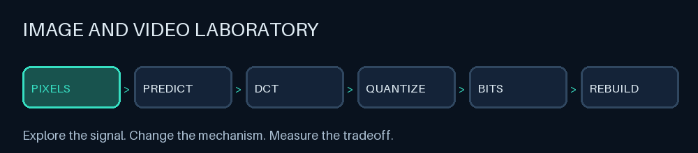
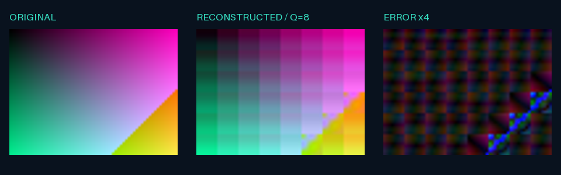
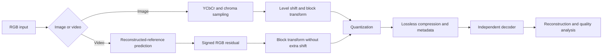

<div align="center">

# Image and Video Laboratory

### An interactive laboratory for image and hybrid video coding

**Explore the signal · Change the mechanism · Measure the tradeoff**




[**Open the live laboratory**](https://image-and-video-laboratory-xp5bshgsbz4ssbvhsbg4f9.streamlit.app/) · [Quick start](#quick-start) · [Experiments](docs/EXPERIMENT_PLAN.md) · [Testing guide](docs/TESTING.md)

</div>

## From pixels to understanding

This project turns an EE596 image/video coding mini-project into a hands-on learning environment. Upload an image or a short video, adjust the encoder, and inspect how prediction, transforms and quantization affect reconstruction and file size.

The animation above illustrates the pipeline. The app's simulations expose real numeric signals and selected search candidates; they are discrete teaching tools rather than real-time CPU visualizations.



## What you can explore

| Laboratory station | Hands-on tools |
|---|---|
| Signals and perception | RGB/YCbCr, channel isolation, 4:4:4 / 4:2:2 / 4:2:0 image sampling |
| Spatial coding | 4×4, 8×8 and 16×16 blocks; DCT/identity; edge/constant padding |
| Quantization | Original JPEG luma/chroma tables, weighted and uniform alternatives |
| Temporal coding | Integer-pixel motion search, SAD/MSE, DC fallback, reconstructed references |
| Mechanism simulation | Block matrices, DC/AC coefficients, quantization zeros, candidate cost traversal |
| Entropy coding | zlib, bzip2, LZMA; illustrative RLE/Huffman symbol demonstrations |
| Rate and quality | Whole-file size search, Q sweeps, PSNR, SSIM, MSE, RMSE, MAE and maximum error |
| Comparisons | Editable labels/notes, selectable runs, zoomable plots, CSV and media downloads |

The default JPEG quantization tables require 8×8 blocks. Choose **weighted** or **uniform** to enable the other block sizes.

## Try it online

**[Launch Image and Video Laboratory](https://image-and-video-laboratory-xp5bshgsbz4ssbvhsbg4f9.streamlit.app/)** — no installation required. Start with the built-in examples, run the validation bench, and explore image and video coding in your browser.

## Quick start

Use Python 3.10 or later. Run these commands in a terminal:

```sh
git clone https://github.com/sahan24854/image-and-video-laboratory.git
cd image-and-video-laboratory
python -m venv .venv
```

Activate the environment:

```sh
# macOS / Linux
source .venv/bin/activate

# Windows PowerShell
.venv\Scripts\Activate.ps1
```

Install and launch:

```sh
python -m pip install -e '.[ui]'
streamlit run app.py
```

Open the local URL printed in your terminal, usually **http://localhost:8501**. Processing happens in your local Python process. No hosted service or API key is required.

### Your first experiment

1. Select **Image** and keep the built-in gradient.
2. Set Q to **0.25** and press **Run experiment**.
3. Add the completed run to the comparison table.
4. Change only Q to **12**, run again and add it.
5. Compare error views, PSNR, SSIM and encoded bytes.
6. Step through **Level shift → DCT → Quantize → Reconstruct** in the simulation.

For video, select the built-in clip and compare **previous**, **motion** and **hybrid** prediction. Move the output frame slider to **frame 8** to inspect the scene change. The expanded [experiment protocol](docs/EXPERIMENT_PLAN.md) covers controlled baselines, seven image experiments, six video experiments and pass/fail criteria.

## Uploads and performance

Images: PNG, JPEG and WebP. Videos: MP4, MOV, MKV, AVI, WebM, M4V and GIF, subject to PyAV's supported codecs. NumPy input uses uint8 RGB arrays shaped `(frames, height, width, 3)`.

Start with **12 frames at 192 pixels wide**. Motion search is a readable Python reference implementation and becomes expensive on large clips. Frame-count and width controls limit ordinary video decoding; measurements compare the resulting analysis frames. Audio is ignored. Source average FPS represents variable-rate clips; synthetic and NumPy inputs use the manual FPS control.

## How the codec works



Video uses 16×16 macroblocks, bounded integer-pixel luminance search and vectors reused across RGB channels. Hybrid mode compares inter prediction cost with an explicitly signaled block-mean DC predictor. I-frames reset dependencies; P-frames reference reconstructed previous frames to prevent drift. Video currently codes RGB 4:4:4 residuals.

Target-size control searches a global Q and measures the **complete encoded stream**, including metadata and side information. Size is not strictly monotonic, so the search is heuristic. Inspect `within_budget` before relying on a maximum target. This is whole-file control, not a CBR buffer controller or strict perceptual-quality guarantee.

## Command line and library

```sh
python -m educodec.cli encode-image input.png image.edc --quantizer jpeg --q 2
python -m educodec.cli decode-image image.edc reconstructed.png
python -m educodec.cli analyze input.png metrics.json --q 2
python -m educodec.cli encode-image input.png sized.edc --target-bytes 20000 --size-mode maximum
python -m educodec.cli encode-video frames.npy video.edc --prediction hybrid --fps 24
python -m educodec.cli decode-video video.edc reconstructed.npy
```

Ordinary container uploads are supported by the UI; the CLI video interface uses NumPy arrays.

```python
import numpy as np
from PIL import Image
from educodec import Config, encode_image, decode_image, quality

original = np.asarray(Image.open('input.png').convert('RGB'))
stream = encode_image(original, Config(q=2, quantizer='jpeg'))
reconstructed = decode_image(stream)
print(quality(original, reconstructed))
```

## Verify and reproduce

```sh
python -m unittest discover -s tests -v
python -m examples.compare
```

The comparison runner creates synthetic inputs, encoded streams, decoded outputs, amplified error views, settings, per-frame metrics and `results/comparison.csv`. Generated results are excluded from Git. Open **Validation bench · guided tests** for executable in-app checks.

Metrics use RGB errors and Gaussian-window luminance SSIM. Video summary PSNR averages frame scores in dB. Infinite PSNR indicates exact reconstruction; CLI JSON represents it as null. Compare methods on the same source and inspect artifacts as well as scores. Synthetic examples establish behavior, not superiority over standard codecs.

## Project map

```text
app.py                   Streamlit laboratory
educodec/codec.py        Independent image/video encoding and decoding
educodec/metrics.py      Full-reference quality measurements
educodec/learning.py     Theory guide and numeric simulations
educodec/charts.py       Interactive comparison plots
educodec/media.py        PyAV container decoding
examples/compare.py      Reproducible comparison runner
tests/                   Codec, lab and UI checks
docs/                    Experiment protocol and testing instructions
EE596_mini_project.ipynb Original coursework implementation
```

## Scope and next experiments

EDC1 is a custom educational stream, not a JPEG/H.264-compatible format. It stores a versioned JSON header and compressed little-endian int32 coefficient/side-information arrays. Decode trusted local files: adversarial-input resource limits are not implemented.

The guide also explains wavelets, directional intra prediction, fractional-pixel and hierarchical motion search, arithmetic/ANS coding, VBV control and perceptual metrics. These are explicitly marked as extensions where not implemented. Useful future contributions include streaming, YCbCr video subsampling, standard-codec benchmarks and more robust input validation.

## Origins and attribution

Developed from the author's EE596 image and video coding project. The original notebook and progress PDF preserve the coursework context. The report references [mVirtuoso21/JPEG-Image-Compressor](https://github.com/mVirtuoso21/JPEG-Image-Compressor) and [simonebenitozzi/jpeg-compression](https://github.com/simonebenitozzi/jpeg-compression).

A redistribution license has not yet been selected. Public availability alone does not grant a software reuse license.

## Host a public demo

Deploy this repository on [Streamlit Community Cloud](https://share.streamlit.io/) using branch `main`, entrypoint `app.py`, and Python 3.12. The root `requirements.txt` installs the app dependencies. Follow the [deployment guide](docs/DEPLOYMENT.md). The current public demo is [available here](https://image-and-video-laboratory-xp5bshgsbz4ssbvhsbg4f9.streamlit.app/). GitHub Pages cannot run this Python application.
